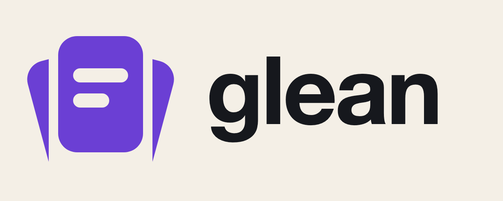

<p align="center">
  <picture>
    <source media="(prefers-color-scheme: dark)" srcset="brand/png/glean-lockup-reversed.png">
    
  </picture>
</p>

Language flashcards for macOS. Each language you study lives in its own space, with its own cards,
history and daily goal. Glean schedules your reviews with spaced repetition (SM-2) and reminds you when
cards are due. You can also ask an AI about any card.

- Cards with translations into your language, a definition, IPA and example sentences
- Review in both directions, from the word to its meaning and from the meaning to the word
- An AI chat that writes cards for you, answers questions about a card and corrects sentences you write
- Pronunciation check and shadowing with Apple's on-device speech recognition
- Streaks, a daily goal, and a coach that finds what you keep forgetting

The AI runs through the [Claude Code](https://claude.com/claude-code) or [Codex](https://github.com/openai/codex)
CLI you already use, with your own login, so Glean needs no API keys. It also works with no AI at all.
There are no accounts and no telemetry. Your data is plain JSON in `~/Glean`.

## Requirements

- macOS 26 or later
- Xcode, or the Command Line Tools (`xcode-select --install`), with Swift 6.2
- Optional: the [Claude Code](https://claude.com/claude-code) or [Codex](https://github.com/openai/codex)
  CLI, installed and signed in, for the AI features

## Install

```bash
git clone https://github.com/martinsbicudo/glean.git
cd glean
make install
```

This builds the app and copies it to `/Applications/Glean.app`.

Then open **Glean ▸ Settings** (⌘,). Under **Connect to**, choose Claude Code, Codex or None, and pick
the hours for reminders. Create your first space from the picker at the top of the sidebar. The
[guide](docs/guide.md) explains everything else.

To remove the app, run `make uninstall`. Your cards in `~/Glean` are kept.

## Build

| Command | What it does |
|---|---|
| `make build` | Release build, assembled and signed as `build/Glean.app` |
| `make install` | `make build`, then copies the app to `/Applications` and relaunches it |
| `make test` | Unit tests (Swift Testing) |
| `make icons` | Regenerates the logo, the app icon and the menu bar icons from `brand/generate.py` |
| `swift build` | Debug build only |

**Signing:** the app is ad-hoc signed by default, which works, but macOS asks again for microphone and
notification permission after every rebuild. To avoid that, sign with a certificate of your own:
create `scripts/signing.local.env` (git ignores it) with the following.

```bash
SIGN_IDENTITY="My Code Signing Certificate"
SIGN_KEYCHAIN="$HOME/Library/Keychains/login.keychain-db"
SIGN_KEYCHAIN_PASSWORD="..."   # only if the keychain is locked
```

[docs/development.md](docs/development.md) covers the details, including the opt-in tests that call
the real AI CLIs and the speech recognizer.

## Contributing

Issues and pull requests are welcome.

1. Read [docs/README.md](docs/README.md) first. It lists the product decisions that are fixed on
   purpose and links to the architecture.
2. Create a branch, make your change, and add tests for any new logic.
3. `make test` must pass, and `swift build` must show no new warnings.
4. Update `docs/` when behavior or settings change.
5. Open a pull request that says what changed and how you tested it.

Code style:
- Match the surrounding code.
- Avoid comments, except to explain a non-obvious *why*.
- Keep files small (around 300 lines at most) and functions under 50 lines.
- Don't use force unwraps or force casts.
- Never swallow an error silently; log it with `Log.write`.
- Don't use `@State` or `#Preview`. The project must also build with the Command Line Tools alone, which
  don't ship SwiftUI's macros. Keep view state in an `ObservableObject` held by `@StateObject` instead.
  The [development docs](docs/development.md#building-without-xcode) explain why.

## Documentation

- [Guide](docs/guide.md): setting up spaces, adding cards, reviewing, pronunciation and where your
  files are
- [Technical docs](docs/README.md): architecture, the AI integration, development and troubleshooting
- [Brand](brand/BRAND.md): logo, colours and icons

## License

[MIT](LICENSE)
