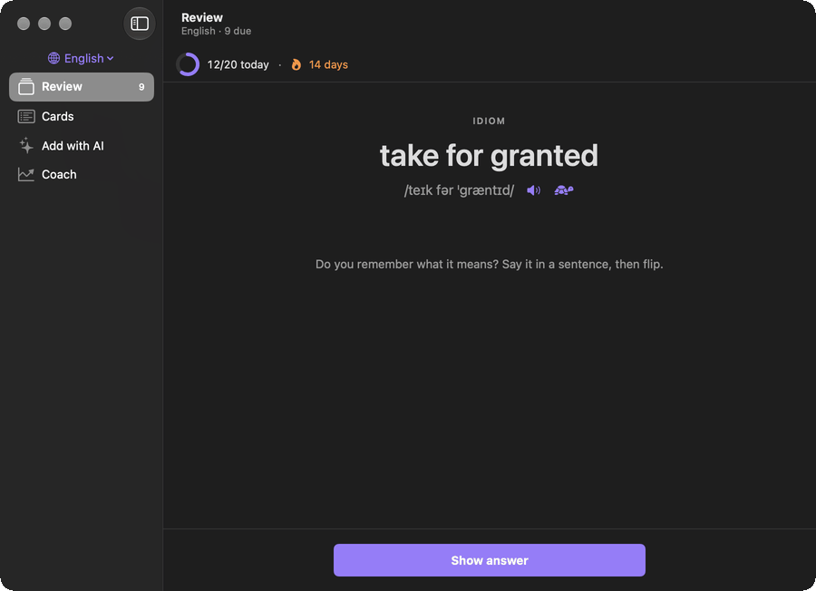
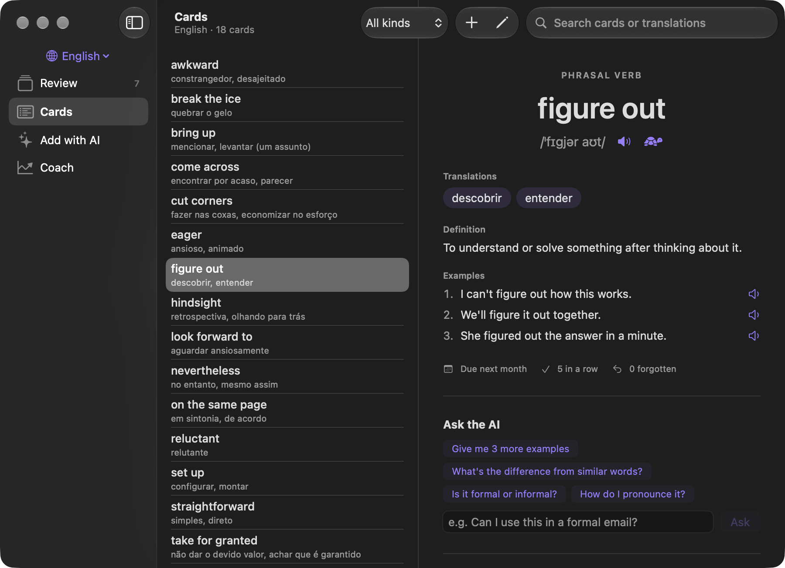
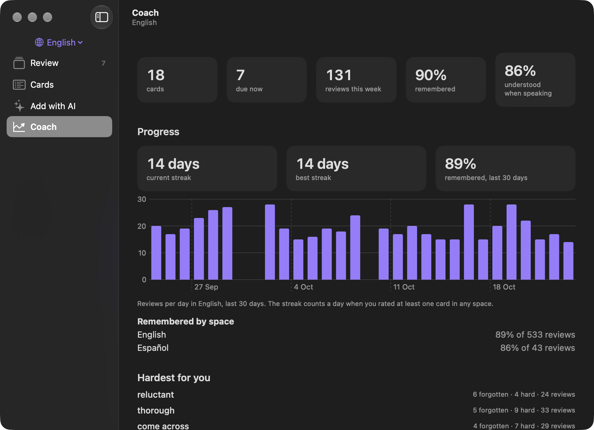

<h1 align="center">
  <picture>
    <source media="(prefers-color-scheme: dark)" srcset="brand/png/glean-lockup-dark.png">
    
  </picture>
</h1>

<p align="center">
  Language flashcards for macOS.<br>
  One space per language, spaced repetition, and an AI tutor that runs on the login you already have.
</p>

<p align="center"></p>

Each language you study lives in its own space, with its own cards, history and daily goal. Glean schedules
your reviews with spaced repetition (SM-2) and reminds you when cards are due. You can also ask an AI about
any card.

- Cards with translations into your language, a definition, IPA and example sentences
- Review in both directions, from the word to its meaning and from the meaning to the word
- An AI chat that writes cards for you, answers questions about a card and corrects sentences you write
- Pronunciation check and shadowing with Apple's on-device speech recognition
- Streaks, a daily goal, and a coach that finds what you keep forgetting

The AI runs through the [Claude Code](https://claude.com/claude-code) or [Codex](https://github.com/openai/codex)
CLI you already use, with your own login, so Glean needs no API keys. It also works with no AI at all.
There are no accounts and no telemetry. Your data is plain JSON in `~/Glean`.

<p align="center">
  
  
</p>

## Contents

- [Requirements](#requirements)
- [Install](#install)
- [Build](#build)
- [Privacy](#privacy)
- [Documentation](#documentation)
- [Contributing](#contributing)
- [License](#license)

## Requirements

| What | Why |
|---|---|
| **macOS 26 or later** | Apple's `SpeechAnalyzer` on-device recognition for the pronunciation check |
| **Xcode, or the Command Line Tools** (`xcode-select --install`), with Swift 6.2 | To build the app. Full Xcode is not needed |
| **[Claude Code](https://claude.com/claude-code) or [Codex](https://github.com/openai/codex)**, installed and signed in (optional) | The AI features. Each uses your existing plan |

Glean is built from source; there is no prebuilt download.

## Install

```bash
git clone https://github.com/martinsbicudo/glean.git
cd glean
make install
```

This builds the app and copies it to `/Applications/Glean.app`.

Then open **Glean ▸ Settings** (⌘,). Under **Connect to**, choose Claude Code, Codex or None, and pick
the hours for reminders. Create your first space from the picker at the top of the sidebar. The
[guide](docs/guide.md) explains everything else.

### Updating and uninstalling

```bash
make install      # after pulling changes: rebuilds and replaces the app, keeps your cards and settings
make uninstall    # removes the app; your cards in ~/Glean stay
```

## Build

| Command | What it does |
|---|---|
| `make build` | Release build, assembled and signed as `build/Glean.app` |
| `make install` | `make build`, then copies the app to `/Applications` and relaunches it |
| `make test` | Unit tests (Swift Testing) |
| `make icons` | Regenerates the logo, the app icon and the menu bar icons from `brand/generate.py` |
| `swift build` | Debug build only |

**Signing:** the app is ad-hoc signed by default, which works, but macOS asks again for microphone and
notification permission after every rebuild. To avoid that, sign with a certificate of your own:
create `scripts/signing.local.env` (git ignores it) with the following.

```bash
SIGN_IDENTITY="My Code Signing Certificate"
SIGN_KEYCHAIN="$HOME/Library/Keychains/login.keychain-db"
SIGN_KEYCHAIN_PASSWORD="..."   # only if the keychain is locked
```

[docs/development.md](docs/development.md) covers the details, including the opt-in tests that call
the real AI CLIs and the speech recognizer.

## Privacy

- Cards, review history and coach reports stay in `~/Glean`; settings in the app's `UserDefaults`.
- Pronunciation is recognized on the Mac. The only outbound traffic is the text of an AI request (a card,
  your question, a sentence you wrote, or your study history for the coach), sent to Anthropic (Claude
  Code) or OpenAI (Codex). With **Connect to: None**, nothing leaves the Mac.
- Claude Code runs with no tools, no MCP servers and no saved session; Codex runs read-only and
  ephemeral. Details in [docs/ai.md](docs/ai.md).
- No analytics, crash reporting or update checks.

## Documentation

- [Guide](docs/guide.md): setting up spaces, adding cards, reviewing, pronunciation and where your
  files are
- [Technical docs](docs/README.md): architecture, the AI integration, development and troubleshooting
- [Brand](brand/BRAND.md): logo, colours and icons

## Contributing

Contributions are welcome. Glean is a small native Swift app (no Xcode project, no dependencies beyond
Apple frameworks), so it's quick to get running.

### Development setup

```bash
xcode-select --install   # if you have neither Xcode nor the Command Line Tools
make test                # unit tests (Swift Testing)
make install             # build and run your change
```

The change loop is: edit `Sources/Glean/…`, `make test`, `make install`. With only the Command Line Tools,
SwiftUI's macros (`@State`, `#Preview`) aren't available, so view state lives in an `ObservableObject` held
by `@StateObject`. The [development docs](docs/development.md#building-without-xcode) explain why.

### How it fits together

```
Space ─► CardStore (cards.json, reviews.jsonl) ─► Scheduler (SM-2) ─► ReviewView
                                               └─► Reminders (due cards)
AI button ─► Tutor ─► Prompts ─► AgentCLI (claude -p / codex exec) ─► CardDraft / SentenceCheck
Mic ─► PronunciationRecorder (SpeechAnalyzer) ─► PronunciationScore ─► Shadowing
```

| Area | Where |
|---|---|
| App, scenes, menu bar | `GleanApp.swift`, `AppModel.swift` |
| Spaces and migration | `Space.swift`, `SpaceStore.swift`, `SpaceSnapshots.swift`, `LegacyMigration.swift` |
| Cards and scheduling | `Card.swift`, `CardStore.swift`, `Scheduler.swift`, `ReviewLog.swift` |
| Claude Code / Codex calls | `AgentCLI.swift`, `Prompts.swift`, `Tutor.swift`, `CardDraft.swift` |
| Pronunciation and shadowing | `Speech.swift`, `PronunciationScore.swift`, `Shadow.swift`, `ShadowSession.swift` |
| Progress and coach | `StudyProgress.swift`, `StudyReport.swift`, `InsightsStore.swift` |
| Icon and colours | `brand/generate.py` ([brand/BRAND.md](brand/BRAND.md)) |

The technical docs in [`docs/`](docs/README.md) explain each part in depth, with the full file map in
[architecture.md](docs/architecture.md).

### Product decisions

These are deliberate. Please open an issue to discuss before changing them:

- **Any language, one space each.** Glean never reads anything outside its own folder.
- AI only through **Claude Code or Codex** CLIs, with the user's own login. No API keys, no local models.
  "None" must keep working.
- **The scheduler is deterministic (SM-2).** The AI never changes intervals.
- Pronunciation only through **Apple's on-device recognizer**. Glean never claims to grade phonemes.
- **Plain files in `~/Glean`.** Spaces are never deleted, only moved to `~/Glean/Trash`.

The reasoning behind each one is in [docs/README.md](docs/README.md#fixed-product-decisions).

### Guidelines

- Every change to logic comes with unit tests in `Tests/GleanTests/`, named after the behavior they protect.
  `make test` must pass, and `swift build` must show no new warnings.
- Keep files small (around 300 lines at most) and functions under 50 lines, and match the existing style:
  descriptive names, no comments except a short *why* that the code can't express.
- Don't use force unwraps or force casts. Never swallow an error silently; log it with `Log.write`.
- When behavior or settings change, update the matching page in `docs/` and, if it's user-facing, this README.
- `make icons` regenerates the brand assets from `brand/generate.py`. It needs the `render_png.py` script
  from the logo-design skill (set `RENDER_PNG=/path/to/render_png.py`); the generated files are committed,
  so you only need it when changing the icon.
- Open a pull request that says what changed and how you tested it.

## License

[MIT](LICENSE) © Victor M. Bicudo. Contributions are accepted under the same license.
